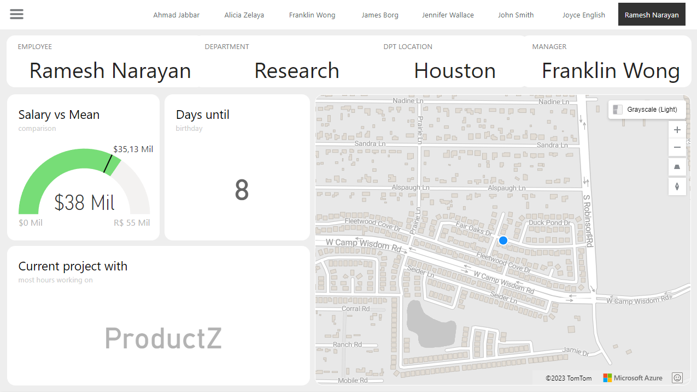
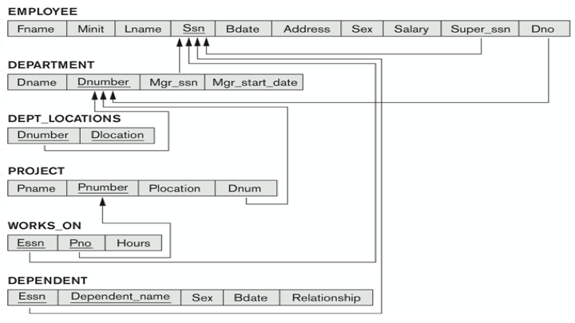

<a id="top"></a>

<div align="center">

<picture>
  <source media="(prefers-color-scheme: dark)" srcset="https://raw.githubusercontent.com/voaneves/azure_company_analysis/main/assets/logo/logo-dark.svg" />
  <source media="(prefers-color-scheme: light)" srcset="https://raw.githubusercontent.com/voaneves/azure_company_analysis/main/assets/logo/logo-light.svg" />
  
</picture>

<h1>Azure Company Analysis</h1>

<p>
  <strong>Analyzes a fictional company's data, stored in Azure MySQL and visualized in Power BI.</strong><br />
  <sub>SQL schema, queries and a Power BI report</sub>
</p>

<p>
  <a href="https://voaneves.github.io/azure_company_analysis/"><picture><source media="(prefers-color-scheme: dark)" srcset="https://raw.githubusercontent.com/voaneves/azure_company_analysis/main/assets/buttons/landing-dark.svg" /></picture></a>
  <a href="https://github.com/voaneves/azure_company_analysis/raw/main/Processando%20e%20Transformando%20Dados%20com%20Power%20BI/Azure%20Company%20Analysis%20%40voaneves.pbix"><picture><source media="(prefers-color-scheme: dark)" srcset="https://raw.githubusercontent.com/voaneves/azure_company_analysis/main/assets/buttons/report-dark.svg" /></picture></a>
</p>

<p><sub>Need something like this? <a href="https://voaneves.com/en/#contact"><strong>Let's talk →</strong></a></sub></p>

<p>
  <a href="https://github.com/voaneves/azure_company_analysis/blob/main/LICENSE"></a>
  
  <a href="https://github.com/voaneves/azure_company_analysis/issues"></a>
</p>

<p>
  <a href="#about-the-project">About</a> ·
  <a href="#methodology">Methodology</a> ·
  <a href="#power-bi-actions-and-analysis">Power BI</a> ·
  <a href="#getting-started">Getting started</a> ·
  <a href="#contact">Contact</a>
</p>

</div>

<picture>
  <source media="(prefers-color-scheme: dark)" srcset="https://raw.githubusercontent.com/voaneves/azure_company_analysis/main/assets/brand/rule-dark.svg" />
  <source media="(prefers-color-scheme: light)" srcset="https://raw.githubusercontent.com/voaneves/azure_company_analysis/main/assets/brand/rule-light.svg" />
  
</picture>

## About the project

This project loads a fictional company's employee, department and project data into a MySQL database on Azure and turns it into an interactive Power BI report.

<p align="center">
  
</p>

Built as a deliverable of the Santander Bootcamp 2023 (Data Science with Python). The challenge instructions are [here](https://github.com/voaneves/azure_company_analysis/blob/main/Processando%20e%20Transformando%20Dados%20com%20Power%20BI/Desafio%20de%20Projeto%20-%20Processando%20e%20Transformando%20Dados%20com%20Power%20BI%20-%20Instru%C3%A7%C3%B5es.docx).

The project covers four steps:

- [X] Create the database schema.
- [X] Extract relevant data.
- [X] Transform this data for analytical purposes.
- [X] Visualize the transformed data using Power BI.

Key points:
- **Structured Design**: The layout is systematically organized for easy navigation and interpretation.
- **Navigational Aids**: Interactive buttons are incorporated to enhance user navigation within the Power BI dashboard.
- **Dynamic Slicers and Image Buttons**: Utilized slicers along with associated image buttons for a more interactive and intuitive filtering experience.
- **Visual Switching**: Implemented indicators and buttons to toggle between different visual representations of the same dataset.

### Technologies Used

The project uses the following technologies:

- Azure: Microsoft Azure is a cloud computing platform offering a range of services like computing power, storage options, and networking capabilities. It allows businesses to run their applications, store data, and perform analytics in a secure and scalable environment.

- MySQL: A widely-used open-source relational database management system that is not exclusive to Microsoft. It is known for its speed, reliability, and ease of use. While it is often used in conjunction with Azure, it is not provided by Microsoft on the Power BI website.

- Power BI Desktop: A powerful business analytics tool by Microsoft that allows you to visualize your data and share insights across your organization, or embed them in an app or website. It offers a desktop-based interface for creating reports and dashboards. While the desktop version is free to use, online publishing and sharing of reports are features available only to Power BI Pro users.

## Project Structure

- Folder 1: Processando e Transformando Dados com Power BI
  - Azure Company Analysis @voaneves.pbix
  - Desafio de Projeto - Processando e Transformando Dados com Power BI - Instruções.docx
- LICENSE
- README.md

## Methodology

The database is described as follows:

<p align="center">
    
</p>

First, let's create the database itself. 

```SQL
-- Create the database called azure_company
CREATE DATABASE azure_company;
```

Now, let's create the tables required for our schema.

### Create table EMPLOYEE

Here, we create an EMPLOYEE table to store information about each employee in the company.

```SQL 
Create table EMPLOYEE
(Fname VARCHAR(15) NOT NULL,
 Minit CHAR,
Lname VARCHAR(15) NOT NULL,
Ssn CHAR(9) NOT NULL,
Bdate DATE,
Address VARCHAR(30),
Sex CHAR,
Salary DECIMAL(10,2),
Super_ssn CHAR(9),
Dno INT NOT NULL,
PRIMARY KEY (Ssn) );
```

### Create table DEPARTMENT

This table stores information about the various departments within the company.

```SQL
Create table DEPARTMENT
(Dname VARCHAR(15) NOT NULL, 
Dnumber INT NOT NULL,
Mgr_ssn CHAR(9) NOT NULL,
Mgr_start_date DATE,
PRIMARY KEY(Dnumber),
UNIQUE(Dname),
FOREIGN KEY(Mgr_ssn)REFERENCES EMPLOYEE(Ssn) );
```

### Create table DEPT_LOCATIONS

A department can have multiple locations, which is what this table represents.

```SQL
Create table DEPT_LOCATIONS
( Dnumber INT NOT NULL,
Dlocation VARCHAR(15) NOT NULL,
PRIMARY KEY(Dnumber, Dlocation),
FOREIGN KEY(Dnumber) REFERENCES DEPARTMENT(Dnumber) );
```

### Create table PROJECT

This table contains details about the projects undertaken by the company.

```SQL
Create table PROJECT
( Pname VARCHAR(15) NOT NULL,
Pnumber INT NOT NULL,
Plocation VARCHAR(15),
Dnum INT NOT NULL,
PRIMARY KEY (Pnumber),
UNIQUE (Pname),
FOREIGN KEY(Dnum) REFERENCES DEPARTMENT(Dnumber) );
```

### Create table WORKS_ON

This table links employees with the projects they are working on.

```SQL
Create table WORKS_ON
( Essn CHAR(9) NOT NULL,
Pno INT NOT NULL,
Hours DECIMAL(3,1) NOT NULL,
PRIMARY KEY(Essn, Pno),
FOREIGN KEY(Essn) REFERENCES EMPLOYEE(Ssn),
FOREIGN KEY (Pno) REFERENCES PROJECT(Pnumber) );
```

### Create table DEPENDENT

To create the **DEPENDENT** table, execute:

```SQL
Create table DEPENDENT
( Essn CHAR(9) NOT NULL,
Dependent_name VARCHAR(15) NOT NULL,
Sex CHAR,
Bdate DATE,
Relationship VARCHAR(8),
PRIMARY KEY(Essn, Dependent_name),
FOREIGN KEY(Essn) REFERENCES EMPLOYEE(Ssn) );
```

Now, let's execute the SQL commands to populate the tables. 

### Insert Values into employee

```SQL
insert into employee values ("John","B","Smith",123456789,"1970-06-20","Houston","M",30000,333445555,5);
insert into employee values ("Franklin","T","Wong",333445555,"1955-12-08","638 Voss, Houston TX","M",40000,888665555,5);
insert into employee values ("Alicia","J","Zelaya",999887777,"1968-01-19","3321 Castle, Spring TX","F",25000,987654321,4);
insert into employee values ("Jennifer","S","Wallace",987654321,"1941-06-20","291 Berry, Bellaire, TX","F",43000,888665555,4);
insert into employee values ("Ahmad","V","Jabbar",987987987,"1969-03-29","980 Dallas, Houston, TX","M",25000,987654321,4);
insert into employee values ("James","E","Borg",888665555,"1937-11-10","450 Stone, Houston, TX","M",55000,NULL,1);
insert into employee values ("Ramesh","K","Narayan",666884444,"1962-09-15","975 Fire Oak, Humble, TX","M",38000,333445555,5);
insert into employee values ("Joyce","A","English",453453453,"1972-07-31","5631 Rice, Houston, TX","F",25000,333445555,5);
```

### Insert Values into department

```SQL
insert into department values ("Research",5,333445555,"1988-05-22");
insert into department values ("Administration",4,987654321,"1995-01-01");
insert into department values ("Headquarters",1,888665555,"1981-06-19");
```

### Insert Values into dept_locations

```SQL
insert into dept_locations values(1,"Houston");
insert into dept_locations values(4,"Stafford");
insert into dept_locations values(5,"Bellaire");
insert into dept_locations values(5,"Sugarland");
insert into dept_locations values(5,"Houston");
```

### Insert Values into PROJECT

```SQL
insert into PROJECT values("ProductX",1,"Bellaire",5);
insert into PROJECT values("ProductY",2,"Sugarland",5);
insert into PROJECT values("ProductZ",3,"Houston",5);
insert into PROJECT values("Computerization",10,"Stafford",4);
insert into PROJECT values("Reorganization",20,"Houston",1);
insert into PROJECT values("Newbenefits",30,"Stafford",4);
```

### Insert Values into WORKS_ON

```SQL
insert into WORKS_ON values(123456789,1,32.5);
insert into WORKS_ON values(123456789,2,7.5);
insert into WORKS_ON values(666884444,3,40);
insert into WORKS_ON values(453453453,1,20);
insert into WORKS_ON values(453453453,2,20);
insert into WORKS_ON values(333445555,2,10);
insert into WORKS_ON values(333445555,3,10);
insert into WORKS_ON values(333445555,10,10);
insert into WORKS_ON values(333445555,20,10);
insert into WORKS_ON values(999887777,30,30);
insert into WORKS_ON values(999887777,10,10);
insert into WORKS_ON values(987987987,10,35);
insert into WORKS_ON values(987987987,30,5);
```

### Add FOREIGN KEY (DNO) to EMPLOYEE

Finally, add the foreign key constraint for the Dno attribute in the EMPLOYEE table:

```SQL
ALTER TABLE EMPLOYEE ADD CONSTRAINT FOREIGN KEY (DNO) REFERENCES DEPARTMENT(DNUMBER);
```

### Queries used

This section provides a collection of SQL queries commonly used in the azure_company project. Each query is enclosed in a dropdown for easy navigation.

<details>
<summary> Q1.retrieve the Salary of every employee </summary>

```SQL
select salary from employee;
```
</details>

<details>
<summary> Q2.retrieve all distinct Salary values </summary>

```SQL
select distinct salary from employee;
```
</details>

<details>
<summary> Q3.retrieve the birth date and address of the employee(s) whose name is "John" </summary>

```SQL
select Bdate , address from employee where Fname = "john";
```
</details>

<details>
<summary> Q4.For each employee, retrieve the employee’s first and last name and the first and last name of his or her immediate supervisor </summary>

```SQL
select E.fname as "employee first name" , E.lname as "employee last name" , S.fname as "manager first name", S.lname as "manager last name"
from employee as E , employee as S
where E.Super_ssn = S.ssn;
```
</details>

 ---

<details>
<summary> Q5.retrieve all info of employees who work in department 5 </summary>

```SQL
select * from employee where Dno = 5;
```
</details>

<details>
<summary> Q6.retrieve all info of employees whose addresses contains Houston </summary>

```SQL
select * from employee where address like '%Houston%';
```
</details>

<details>
<summary> Q7.retrieve all info of employees whose salaries between 40000 and 30000 </summary>

```SQL
select * from employee where Salary between 30000 and 40000;
```
</details>

<details>
<summary> Q8.retrieve first name of all employees ordered alphabetically  </summary>

```SQL
select fname from employee order by Fname asc;
```
</details>

<details>
<summary> Q9.retrieve names of all employees who do not have supervisor </summary>

```SQL
select fname from employee where Super_ssn is null;

```
</details>

<details>
<summary> Q10.retrieve name of every employee whose Salary is greater than all the salaries of employees in department 5 </summary>

```SQL
select fname ,Salary
from employee 
where salary > All ( select salary 
                     from employee
                     where dno = 5
                          ) ;
```
</details>

<details>
<summary> Q11.max , min , avg , sum ,count </summary>

```SQL
SELECT SUM(Salary), MAX(Salary), MIN(Salary), AVG(Salary) , count(salary)
FROM	EMPLOYEE;
```
</details>

<details>
<summary> Q12.select the Essns of all employees who work the same (project, hours) combination on some project 
that employee ‘John Smith’ (whose Ssn = ‘123456789’) works on  </summary>

```SQL
select distinct Essn 
from works_on where (pno , hours) in ( select pno , hours
                         from works_on
                         where Essn = "123456789"
                         );
```
</details>

## Power BI actions and analysis

This section outlines the series of actions performed in Power BI to clean, transform, and analyze the data from the azure_company database. Each step is crucial for ensuring data integrity and for preparing the data for meaningful analysis.

### Data Preparation Steps

1. **Check Headers and Data Types**: Verify the headers and data types of each column in the data set.
   
2. **Modify Monetary Values**: Convert all monetary values to double precision type.

3. **Null Value Analysis**: Check for the existence of null values and consider their removal.

4. **Identify Managers**: Employees with null values in the `Super_ssn` field may be managers. Validate if there are any employees without a manager.

5. **Check for Departments Without Managers**: Verify if there are any departments without a designated manager.

6. **Fill in Missing Manager Information**: If there are departments without managers, assume you have the necessary data and fill in the gaps.

### Data Transformation Steps

7. **Examine Project Hours**: Review the number of hours allocated to each project.

8. **Split Complex Columns**: Divide columns containing multiple types of information.

9. **Merge Employee and Department Queries**: Create a new table by merging the `employee` and `department` tables, focusing on the `employee` table as the base. The type of join will depend on the specific requirements.

10. **Remove Unnecessary Columns**: Eliminate columns that are not essential for further analysis.

11. **Join Employees and Manager Names**: This can be done either using SQL queries or by merging tables in Power BI. If SQL is used, specify the query in the README.

12. **Merge First and Last Names**: Combine the first and last names into a single column to represent each employee's full name.

13. **Merge Department Names and Locations**: Combine the names of departments with their locations to create unique department-location combinations. This will be useful for creating a star schema in future modules.

14. **Explanation for Merging vs. Assigning**: Explain why, in this specific case, merging is preferable to assigning.

### Data Analysis Steps

15. **Group Data by Manager**: Aggregate the data to find out how many employees are managed by each manager.

16. **Remove Further Unnecessary Columns**: Delete columns that will not be used in the final report.

### Measures

17. Department Location of biggest project and it's characteristics
```DAX
Department Location of biggest project = IF(ISBLANK(MAXX (
    FILTER ( 'company project', 'company project'[Pnumber] = [Most hours project number] ),
    'company project'[Plocation]
)), "Headquarters", MAXX (
    FILTER ( 'company project', 'company project'[Pnumber] = [Most hours project number] ),
    'company project'[Plocation]
))

Most hours project name = IF(ISBLANK(MAXX (
    FILTER ( 'company project', 'company project'[Pnumber] = [Most hours project number] ),
    'company project'[Pname]
)), "Management", MAXX (
    FILTER ( 'company project', 'company project'[Pnumber] = [Most hours project number] ),
    'company project'[Pname]
))

Max Number of Hours Project = CALCULATE ( IF ( ISFILTERED ( 'Employee-Ssn'[FLname] ), MAX( 'company works_on'[Hours] ), "None" ))

Most hours project number = MAXX (
    FILTER ( 'company works_on', 'company works_on'[Hours] = [Max Number of Hours Project] ),
    'company works_on'[Pno]
)
```

18. Selected Employee and it's characteristics
```DAX 
Selected Employee = CALCULATE ( IF ( ISFILTERED ( 'Employee-Ssn'[FLname] ), SELECTEDVALUE( 'Employee-Ssn'[FLname] ), "None" ))

Selected Department = CALCULATE ( IF ( ISFILTERED ( 'Employee-Ssn'[FLname] ), FIRSTNONBLANK('employee+dp+mgr'[Department], 1), "None" ))

Selected Manager = CALCULATE ( IF ( ISFILTERED ( 'Employee-Ssn'[FLname] ), IF(ISBLANK(FIRSTNONBLANK('employee+dp+mgr'[Manager], 1)), "None", FIRSTNONBLANK('employee+dp+mgr'[Manager], 1)), "None" ))

Selected Address = CALCULATE ( IF ( ISFILTERED ( 'Employee-Ssn'[FLname] ), FIRSTNONBLANK('Mescla Employee-Department'[Address], 1), "None" ))

Selected Salary = CALCULATE ( IF ( ISFILTERED ( 'Employee-Ssn'[FLname] ), FIRSTNONBLANK('Mescla Employee-Department'[Salary], 1), "None" ))
```

19. Days until birtday
```DAX
Days until Bday = IF(
    DATEDIFF (
        TODAY (),
        DATE ( YEAR ( TODAY () ), MONTH ( FIRSTNONBLANK('Mescla Employee-Department'[Bdate], 1 )), DAY ( FIRSTNONBLANK('Mescla Employee-Department'[Bdate], 1 )) ),
        DAY
    ) < 0, "Next year...", IF( DATEDIFF (
        TODAY (),
        DATE ( YEAR ( TODAY () ), MONTH ( FIRSTNONBLANK('Mescla Employee-Department'[Bdate], 1 )), DAY ( FIRSTNONBLANK('Mescla Employee-Department'[Bdate], 1 )) ),
        DAY
    ) = 0, "Today", DATEDIFF (
        TODAY (),
        DATE ( YEAR ( TODAY () ), MONTH ( FIRSTNONBLANK('Mescla Employee-Department'[Bdate], 1 )), DAY ( FIRSTNONBLANK('Mescla Employee-Department'[Bdate], 1 )) ),
        DAY
    )
    ))
```

20. Salary gauge vs mean
```DAX
Color = IF([Selected Salary]>[Mean Salary],"#77DD77","#FF6961")

Max Salary = CALCULATE(
    MAX('Mescla Employee-Department'[Salary]),
    ALLEXCEPT('Mescla Employee-Department', 'Mescla Employee-Department'[Salary])
)

Mean Salary = CALCULATE(
    AVERAGE('Mescla Employee-Department'[Salary]),
    ALLEXCEPT('Mescla Employee-Department', 'Mescla Employee-Department'[Salary])
)

Min Salary = CALCULATE(
    MIN('Mescla Employee-Department'[Salary]),
    ALLEXCEPT('Mescla Employee-Department', 'Mescla Employee-Department'[Salary])
)
```

## Attachments

- [Power BI Service](https://app.powerbi.com/groups/me/reports/bcd5989a-4eb6-4dc8-ad22-2be03c33fdc3?pbi_source=desktop) (requires a Power BI account)
- [GitHub PBIX File](https://github.com/voaneves/azure_company_analysis/blob/main/Processando%20e%20Transformando%20Dados%20com%20Power%20BI/Azure%20Company%20Analysis%20%40voaneves.pbix)

## Getting started

1. Download [`Azure Company Analysis @voaneves.pbix`](https://github.com/voaneves/azure_company_analysis/raw/main/Processando%20e%20Transformando%20Dados%20com%20Power%20BI/Azure%20Company%20Analysis%20%40voaneves.pbix) and open it in Power BI Desktop (Windows).
2. To rebuild the database, run the SQL from [Methodology](#methodology) on a MySQL server, such as Azure Database for MySQL.
3. Point the report's data source to your server and refresh.

## To do

- [ ] Add more pages.
- [ ] Make the "toggle button" more functional and improve the report structure.

## Reporting bugs

1. Check whether the bug is already in [Issues](https://github.com/voaneves/azure_company_analysis/issues).
2. If not, open a new issue with a clear title and the steps to reproduce it.
3. If possible, include screenshots or the query that fails.

Pull requests are welcome.

## Contact

<p>
  <a href="https://voaneves.com/en/#contact"><picture><source media="(prefers-color-scheme: dark)" srcset="https://raw.githubusercontent.com/voaneves/azure_company_analysis/main/assets/buttons/hire-dark.svg" /></picture></a>
  <a href="https://voaneves.com/en/"><picture><source media="(prefers-color-scheme: dark)" srcset="https://raw.githubusercontent.com/voaneves/azure_company_analysis/main/assets/buttons/site-dark.svg" /></picture></a>
</p>

<a href="https://linkedin.com/in/voaneves">LinkedIn</a> · <a href="mailto:victorneves478@gmail.com">E-mail</a>

<p align="center">
  
</p>

<p align="center"><sub>Released under the <a href="https://github.com/voaneves/azure_company_analysis/blob/main/LICENSE">MIT License</a>.</sub></p>

<p align="center"><sub><a href="#top">↑ Back to top</a></sub></p>
